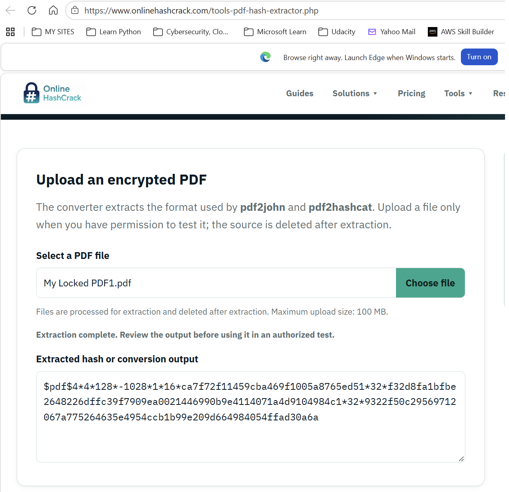
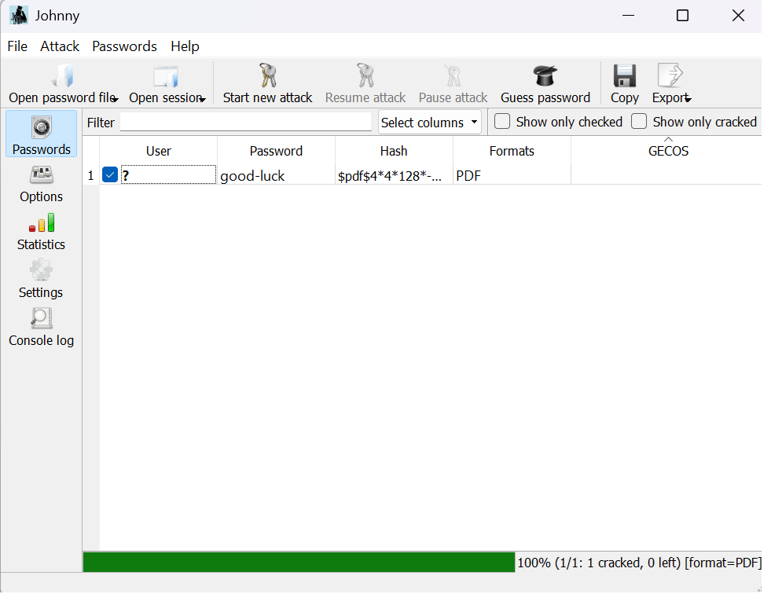
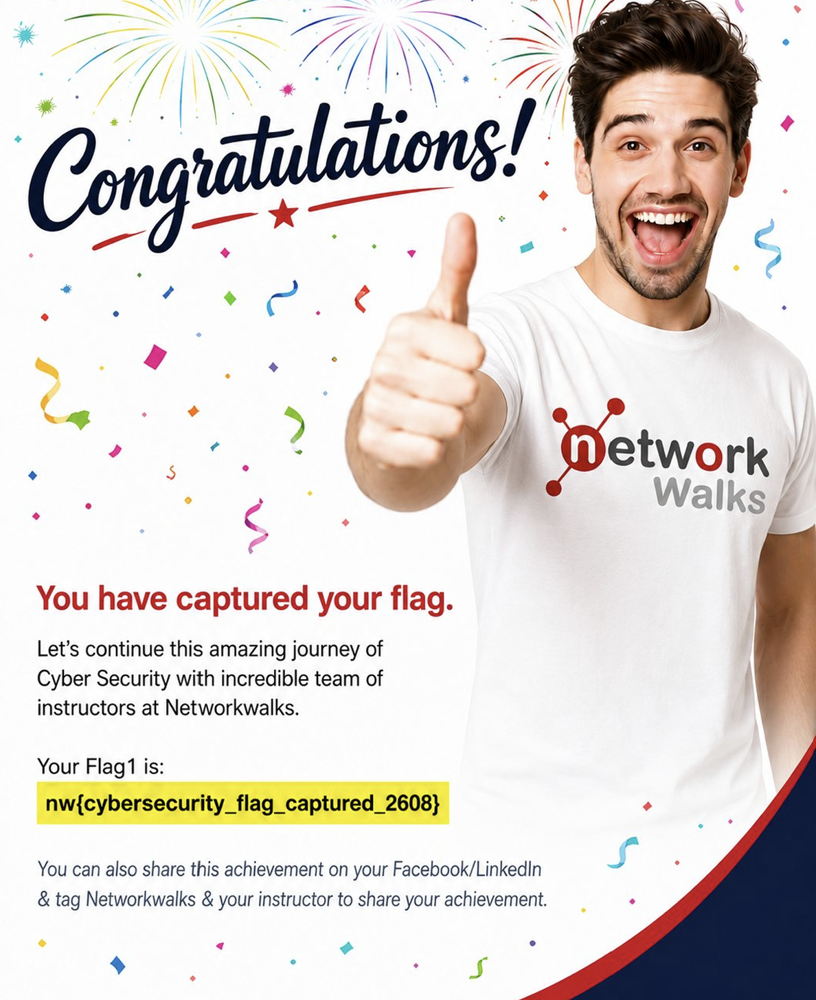
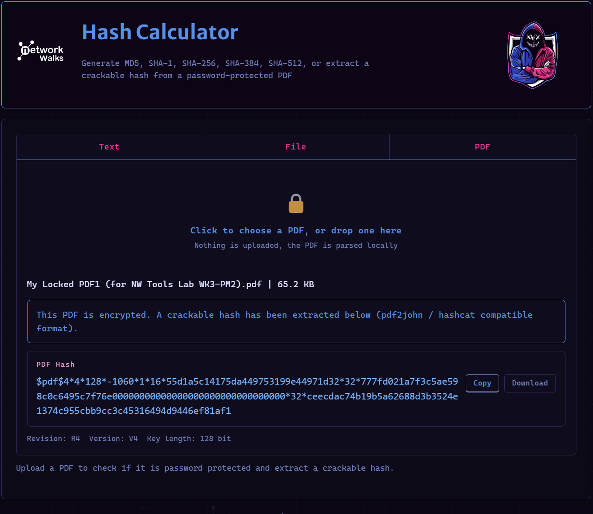
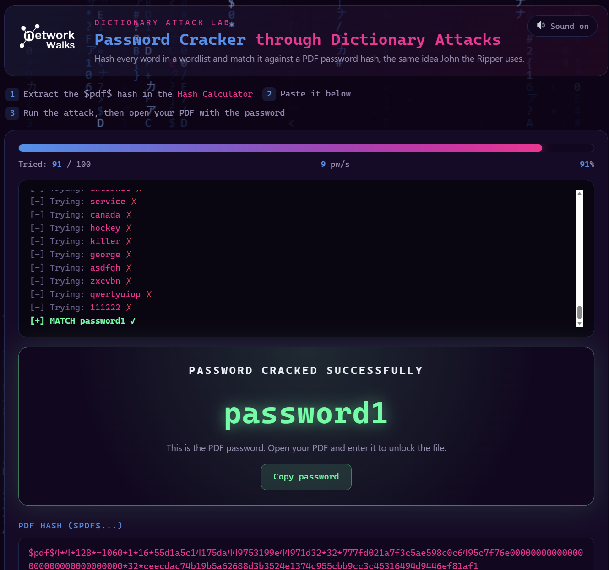

# Password Cracking Labs

## Overview

This repository contains the completion of Week 3 cybersecurity password auditing and password recovery labs.

The objective was to understand how password-protected PDF files can be converted into hashes and how password recovery tools can be used to demonstrate the importance of strong passwords.

---

## Password Cracking with John The Ripper (JTR)

### Skills Practiced

- PDF hash extraction
- Hash identification
- John The Ripper (JTR)
- Johnny GUI
- Password auditing
- Password recovery workflow

### Process

1. Extracted the PDF hash.
2. Loaded the hash into Johnny (JTR GUI).
3. Performed a password cracking attack.
4. Successfully recovered the password.
5. Opened the protected PDF.
6. Captured the challenge flag.

### Evidence

#### Hash Extraction

#### Password Cracked

#### Flag Captured

---

## Module 2 - Password Cracking with NetworkWalks Tools

### Skills Practiced

- PDF hash extraction
- Hash analysis
- Dictionary attack concepts
- Password recovery workflow

### Process

1. Uploaded the protected PDF to the NetworkWalks Hash Calculator.
2. Extracted the PDF hash.
3. Submitted the hash to the Password Cracker.
4. Successfully recovered the password.
5. Opened the encrypted PDF.
6. Captured the challenge flag.

### Evidence

#### Hash Calculator

#### Password Cracked

#### Flag Captured

---

## Key Lessons Learned

- Passwords are typically stored as hashes rather than plaintext.
- Weak passwords can often be recovered using dictionary-based attacks.
- Password security depends heavily on password complexity and unpredictability.
- Password recovery tools are useful for security auditing and password strength assessments.

---

## Technologies Used

- John The Ripper (JTR)
- Johnny GUI
- NetworkWalks Hash Calculator
- NetworkWalks Password Cracker
- PDF Hash Extraction Tools

---

## Disclaimer

This repository contains educational laboratory exercises completed in an authorized training environment. No unauthorized systems, accounts, or third-party assets were targeted.
